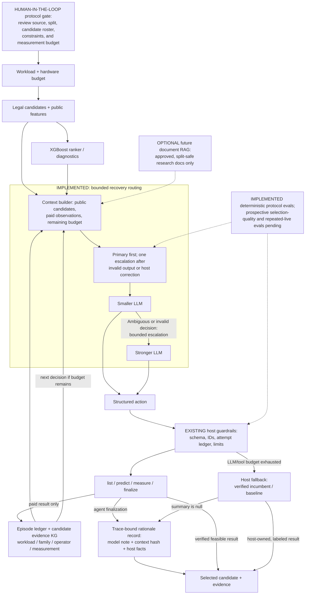

**Latest October 28 status:** local lexical, TF-IDF/SVD latent-semantic, hybrid, and candidate-evidence-graph retrieval are implemented. The five-mode archived replay preserves all deterministic controls (50 trajectories / 150 endpoints / zero LLM calls / zero new native jobs); it demonstrates noninterference only. Two live retrieval episodes on a consumed pool are documented, and merit/frequency reach the same pool oracle sooner, so no retrieval or agent advantage is established. See [implementation and run](../../docs/agent-memory-operations.md) and the [pilot](../../results/2026-10-28-live-luna-memory/README.md). Deployment, pretrained embeddings, and general-document retrieval remain planned.

**October 28 implementation update:** slide assets are paused; this architecture note is current documentation. Bounded recovery routing escalates once after malformed structured output or an explicit host incumbent correction; model/tool exhaustion closes through a distinct host-owned incumbent/baseline fallback. The existing model-authored `finalize.summary` is now bound to a hash of the exact visible context and logged alongside separate host-verified facts and measurement references. The note remains unverified prose. Uncertainty/cost-triggered routing, interactive runtime approval, general-document RAG, and production operations remain planned. See [implementation status](../../docs/agent-routing-implementation.md) and [Evals](../../docs/agent-evals.md).

# ISAForge agent architecture: current system and proposed extensions

**Status: bounded recovery, host fallback, scoped memory, and deterministic protocol evals are implemented; model-quality comparison remains open.** The selector may use one stronger-model call after malformed structured output or explicit host correction. If the agent errors or exhausts its model/tool budget, the host records a distinct incumbent/baseline fallback. These paths are software-tested; no prospective same-budget live agent comparison exists. The graph and retrieval modes have no proven selection benefit. Interactive human approval inside the running agent, uncertainty/cost-based routing, general-document RAG, a vector database, LangGraph/LangChain, MCP integration, and production monitoring remain unimplemented or unevaluated. Do not present planned boxes as completed work.

The **human-in-the-loop** is currently a manual research-release gate: a researcher freezes and reviews source/input lineage, workload/family split, candidate roster, constraints, and the measurement allowance before target outcomes are revealed. The live selector has no interactive per-measurement approval callback. Record reviewer, approval/rejection, reason, and elapsed human time in a future prospective campaign; do not describe a planned runtime gate as implemented.

## Working now

- The local host exposes four actions: `list_candidates`, `predict`, `measure`, and `finalize`. It validates structured actions, keeps target outcomes private until permitted queries, charges invalid/repeated attempts, limits calls, and permits only paid, correctness-passing designs that satisfy measured constraints (or baseline). On model/tool exhaustion it makes a distinct host-owned fallback to the incumbent/baseline; it does not count another call or hardware attempt. A persistent ledger records actions, results and failures. The remote provider uses strict function schemas; the current-chat bridge relays JSON actions interactively. See [bounded-selection contract](../../docs/bounded-selection.md) and [chat pilot](../../docs/codex-chat-selector-pilot.md).
- The EDN chat pilot replayed an archived outcome; it did not run a new hardware job. The Ascon session did perform three native measurements. Its GP success-status omission prevented live GP updates, so post-fix validation is not evidence of successful live adaptation. Neither pilot proves agent superiority.
- The existing remote provider records model identity, call time and token use when returned; the interactive Codex chat does not expose exact deployment identity or token accounting. This is useful experiment logging, not a deployed production observability platform.
- Historical retrieval now includes a **read-only candidate evidence graph prototype**: workload, candidate, expression-family, operator, and measured-result nodes with hashes and explicit relations. It retrieves approved historical records by operator overlap and returns relation paths. Target-workload and formula-family exclusions are checked again at graph lookup. The prototype has software tests but no live LLM benefit result; see the [graph contract](../../docs/candidate-evidence-graph.md).
- Deterministic agent evals exercise structured outputs, tool/ID validity, attempt accounting, host correction, fallback, target-roster stability, and export integrity. A five-mode archived replay preserves all matched controls; this is not retrieval or selection-quality evidence. An optional LLM judge is reserved for secondary explanation-quality scoring after host verification; it cannot grade correctness, feasibility, or speedup. See [agent evals](../../docs/agent-evals.md).
- The `finalize.summary` is an LLM-authored decision explanation. It is not itself proof. A trace-bound record stores the exact public-context hash, unverified model note, selected-design facts, constraints, evidence references, and policy/provider trace. It adds no second LLM call. Host fallback records its selected facts with `summary=null`.

## Implemented recovery; proposed uncertainty/cost routing

1. Freeze an allowlist of two available model IDs and versions, a deterministic routing rule, a common prompt/tool schema, a maximum number of model calls, an input/output token budget and a wall-time budget before a test. Start with a smaller model for each decision. Escalate at most once if the response is invalid after schema validation, the candidate evidence is ambiguous under a predeclared feature-based rule, or a logged decision-risk trigger fires. Never use hidden target outcomes to choose the route. Without calibrated uncertainty, describe thresholds as heuristics and test them rather than calling them probabilities.
2. The host—not the LLM—reserves and charges hardware attempts, enforces exact candidate IDs and legal tools, validates hardware constraints, and returns baseline or the best paid verified feasible incumbent on exhaustion. Model/tool exhaustion is now recorded as a host fallback. Escalating an LLM does not itself spend a hardware attempt, but does spend model calls, tokens, time and money. Do not silently retry an interrupted or already charged hardware job.
3. Construct the context window from the current public candidate roster, frozen predictions, budget, and the episode's paid observations. Persist raw state and provenance, then build a bounded prompt for each call. Agent memory is the ledger and derived public state, **not unrestricted access to historical target labels**. Track token counts and truncation; use explicit summaries if necessary, preserving IDs and evidence links.
4. Compare the routed policy with fixed-small, fixed-strong, non-agent active learning, merit, frequency and random using equal target workload pools, features, constraints and hardware-attempt budgets. Separately cap and report model calls, tokens, actual cost and elapsed time; fixed models may consume different LLM budgets. Report measured best feasible performance and oracle regret, failures, tool correctness, escalation rate and quality/cost tradeoffs. Freeze policies before new target outcomes; report historical training measurements and avoid tuning on the test cohort.

**Why route?** It might reduce LLM cost on routine decisions while retaining stronger reasoning for difficult cases. That is a hypothesis; no quality or cost advantage exists until measured. Small model and strong model are roles, not verified specific model choices.

## Optional retrieval: only if it helps decisions

For a larger historical evidence library, a separate RAG component could chunk approved research notes and prior-workload records, create embeddings, index them in a vector database, combine lexical and semantic retrieval (hybrid search), and rerank a small source-linked set for the selector. Start with plain structured lookup and no retrieval; add this only if a tested information need justifies it.

Before indexing or retrieval, enforce workload/family and evaluation-split provenance: exclude the entire current target's hidden outcomes and contaminated sources, preserve source IDs, verify content hashes, and test leakage with canaries. Retrieved material is untrusted data, not an instruction to the agent. Compare retrieval against no retrieval under matched information and hardware budgets. Keep ranking the **retrieved documents** separate from XGBoost ranking of **instruction candidates**. RAG can introduce stale context and outcome leakage; it does not replace the measurement ledger or performance oracle.

## Technology vocabulary and honest status

| Term | Project role / status |
| --- | --- |
| Tokens and context windows | The request is bounded by 200,000 bytes; the selector now exposes remaining decision turns, and the routed provider enforces its shared dispatched-call cap. Returned token usage is recorded when available; aggregate input-token and dollar ceilings are not implemented. |
| Structured outputs and function calling | Implemented in the remote provider's strict four-tool interface; the chat bridge uses structured JSON actions. |
| AI agents, agentic workflows, loop engineering | Existing bounded selector loop includes one recovery route, deterministic host verification, and a host-owned incumbent fallback. Matched live controls are still needed to show value. |
| Agent memory | Existing paid-outcome ledger plus a local, provenance-linked candidate evidence graph prototype; retrieval benefit is not established. |
| Guardrails | Existing host-enforced schema, budgets, IDs, correctness and hardware feasibility; extend with routing/context limits. |
| Semantic/hybrid retrieval and knowledge graph | Local TF-IDF + truncated-SVD semantic mode, reciprocal-rank-fused hybrid mode, and typed operator-overlap candidate graph are implemented over approved historical rows. Retrieval benefit is unknown; graph similarity is not a speedup prediction. |
| Pretrained embeddings, arbitrary-document chunking, vector databases, general RAG, reranking | Not implemented and not needed for the present small structured evidence table. Consider only after a measured missing-context problem and split-safe prospective ablation. |
| LangGraph / LangChain | Possible orchestration libraries if the current host becomes difficult to maintain; neither is currently used or needed to establish the research result. Any checkpoint/retry integration must preserve the host's one-charge semantics. |
| MCP | Possible future protocol adapter for the existing allowlisted tools, not a requirement or a substitute for host authorization; current remote provider has no MCP tool access. |
| LLM evaluations / Ragas | Deterministic tool/loop regression, trace-bound decision notes, and archived replay are implemented. Repeated live-model reliability and prospective agent-quality comparisons are pending. A blinded, human-calibrated LLM judge may score explanation clarity only; host verification decides engineering outcomes. Ragas is not needed for the current structured-history corpus. |
| Human-in-the-loop | Manual protocol/release review freezes workload lineage, leakage splits, roster, budgets, and authorization before expensive measurements. Interactive runtime approval and human-time accounting are planned, not implemented. |
| LLM observability / LLMOps | Existing logs capture some provider metadata; a versioned dashboard, model/prompt release process, monitoring, deployment and prospective tests are proposed, not completed. |

For a practical LLMOps lifecycle: **build and version** prompt, schemas, model IDs and data manifests; **evaluate** frozen policies against same-budget controls; **monitor** tool errors, quality, token spend and latency where deployed; and **deploy** only a tested selector with rollback and a deterministic fallback. Model-evaluation and hardware-evaluation expenses must both be recorded.

## Primary documentation consulted

- [LangGraph: thinking in state and durable workflow steps](https://docs.langchain.com/oss/javascript/langgraph/thinking-in-langgraph). Framework concepts support explicit state and checkpoints; they do not replace our paid-attempt ledger.
- [Ragas: available metrics](https://docs.ragas.io/en/latest/concepts/metrics/available_metrics/). Includes retrieval and agent/tool metrics; hardware outcomes remain the primary endpoint.
- [MCP: tool annotations and limits](https://blog.modelcontextprotocol.io/posts/2026-03-16-tool-annotations/). Tool annotations are hints; the host still needs actual enforcement.

## Placement and adoption evaluation for the presentation

The runtime architecture has four stages: legal candidate analysis and ML scoring; an LLM decision; a host-enforced tool dispatch; and measured evidence stored for the next decision. The loop ends at the best paid, verified feasible design or baseline. A development-time coding agent and its subagents help build and review these stages, but are not runtime selectors or evidence of better hardware performance.

| Concept | Where it fits | Benefit and adoption test |
| --- | --- | --- |
| Tokens | Each LLM request and response | Account for input/output usage and cost. Introduce explicit ceilings; report missing usage rather than zero. |
| Context windows | Before each LLM decision | Supply roster, predictions, constraints and paid observations. Test truncation preserves exact candidate IDs, budgets and incumbent. |
| Dynamic LLM usage | Between context builder and provider | Implemented one escalation after malformed output or explicit host incumbent correction, under a shared call cap. If the loop fails or exhausts its budget, the host records an incumbent/baseline fallback. Live matched evaluation is pending; uncertainty/cost routing remains planned. |
| Model training | Numerical model versus LLM selector | XGBoost is fit from measured candidate outcomes. The LLM is not fine-tuned; it uses a fixed model/prompt, structured tools, current episode state, and approved historical measurements as context. Logged rationale text is an audit artifact, not a training label. |
| Structured outputs | LLM action boundary | Existing schemas make actions machine-checkable. A schema-valid proposal can still be a bad selection. |
| Function calling | Decision-to-host interface | Existing four tools make requests executable. The host validates and charges actions independently. |
| AI agents / agentic workflows | Observe, propose, act, observe again | Existing bounded selector and pilots demonstrate execution. Matched controls are still needed to demonstrate value. |
| Loop engineering | Controller state transitions | Existing loop preserves stop rules and paid attempts; model/tool exhaustion now records a host-owned incumbent fallback. Restart/recovery without duplicate paid dispatch remains unimplemented. |
| Agent memory | Evidence ledger feeding context | Existing records preserve paid results. Planned summaries must retain provenance and cannot introduce unqueried labels. |
| Guardrails | Before dispatch and final selection | Existing budgets, schemas and feasibility checks. Extend with model-call and token limits; verify negative cases. |
| Chunking | Optional approved-document ingestion | Split by experiment/method with source and split provenance. Useful only when structured lookup cannot supply necessary context. |
| Embeddings | Optional representation of those chunks | Enable conceptual similarity. They do not estimate candidate speedup. Test useful retrieval on development questions. |
| Vector databases | Optional storage of embeddings | Useful at larger retrieval scale. A small document set can start with a local index; a separate database is not inherently needed. |
| Semantic search | Optional evidence retrieval | Find conceptually related methods. Evaluate relevant-source recall and contamination. |
| Hybrid search | Optional retrieval before context | Combine semantic matching with exact instruction names and workload identifiers. Compare with simple lexical lookup. |
| Reranking | After document retrieval | Reorder retrieved evidence for relevance. Separate this from the existing XGBoost ranking of instruction candidates. |
| RAG | Evidence retrieval into LLM context | Supply source-linked prior knowledge. Add only if it improves decisions over equal-information no-retrieval controls. Never retrieve hidden target measurements. |
| LangGraph | Optional replacement for orchestration plumbing | Consider explicit durable state only if current controller maintenance warrants it. Preserve existing paid-attempt semantics. No migration needed for the presentation. |
| LangChain | Optional provider/retriever integration | Consider if it removes concrete adapter work. It is not a research contribution or current dependency. |
| MCP | Optional adapter around existing tools | Enables interoperable clients. Keep tool allowlists and enforcement in the host. Not currently the selector protocol. |
| LLM evaluations | Offline policy replay, then frozen prospective tests | Primary endpoint: best verified feasible performance per evaluation budget. Also record errors, cost, escalation and latency. |
| Ragas | Optional retrieval/tool evaluation tooling | Can supplement evidence-relevance or tool metrics if retrieval exists. Cannot substitute for cycle, synthesis and routing measurements. |
| LLM observability | Around model calls and tool dispatch | Existing metadata is partial. Planned traces join model decisions to charged jobs, timing, tokens and failures. |
| LLMOps | Across build, evaluate, monitor and deploy | Version prompts, model IDs, schemas, manifests and routing rules; test frozen releases; monitor operational cost; deploy with rollback and fallback. Production deployment remains planned. |

### Recommended implementation order after the presentation

1. Complete task-specific trace and evaluation accounting using the existing controller. Record provider/model version, prompt/schema hashes, request IDs, tokens when available, latency, charged attempt IDs and feasible incumbent. Keep historical training costs separate and visible.
2. Test a fixed-model selector against strong heuristics and non-agent active learning under a frozen shared information and measurement contract. Include tool validity, baseline retention and interruption tests.
3. Add a small bounded router only after those controls work. Compare fixed-small, fixed-strong and routed policies on feasible performance and actual model cost. Change one factor at a time.
4. Add retrieval only when an explicit missing-information failure supports it. First try structured source lookup. Test retrieval without target-label leakage before allowing it in a selection trial.
5. Adopt frameworks or deploy a service only when they solve a demonstrated operational need. They are optional implementation choices rather than milestones in the core research result.

### Slide 8 speaking script (45 seconds)

Our agent has four stages: analyze candidates and query ML predictions, choose a structured action, execute it through host guardrails, and record measured evidence. Paid observations feed the next decision. The lower half shows planned extensions. The bounded router currently escalates only after malformed structured output or an explicit host incumbent correction; it does not infer decision difficulty or route by cost. Optional retrieval from approved historical evidence uses local TF-IDF/LSA hybrid search, but pretrained embeddings, general document retrieval, and reranking are not implemented. Across the system, LLMOps would version releases and track quality, tokens, latency and cost. We will judge every addition by verified feasible performance under the same measurement budget.

For Q&A: LangGraph and LangChain could support orchestration and integrations, MCP could expose tools, and Ragas could assess retrieval. These are optional choices, not components we claim to have built. Coding subagents are a separate AI-assisted development workflow.
