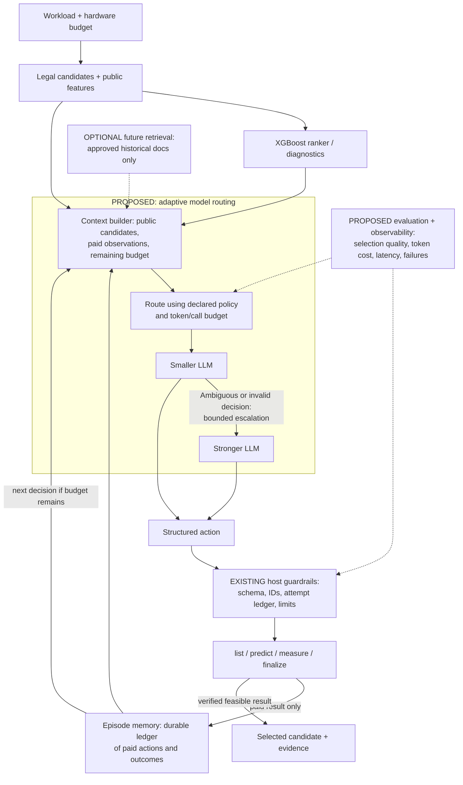

# ISAForge agent architecture: current system and proposed extensions

**Status: presentation design and research plan.** Dynamic LLM routing, RAG, a vector database, LangGraph/LangChain, MCP, Ragas, and production monitoring have not been implemented or evaluated for the selector. A historical rule-based router between LUT-cost predictors is a different experiment. Do not present the proposed boxes as completed work.

## Working now

- The local host exposes four actions: `list_candidates`, `predict`, `measure`, and `finalize`. It validates structured actions, keeps target outcomes private until permitted queries, charges invalid/repeated attempts, limits calls, and permits only paid, correctness-passing designs that satisfy measured constraints (or baseline). A persistent ledger records actions, results and failures. The remote provider uses strict function schemas; the current-chat bridge relays JSON actions interactively. See [bounded-selection contract](../../docs/bounded-selection.md) and [chat pilot](../../docs/codex-chat-selector-pilot.md).
- The EDN chat pilot replayed an archived outcome; it did not run a new hardware job. The Ascon session did perform three native measurements. Its GP success-status omission prevented live GP updates, so post-fix validation is not evidence of successful live adaptation. Neither pilot proves agent superiority.
- The existing remote provider records model identity, call time and token use when returned; the interactive Codex chat does not expose exact deployment identity or token accounting. This is useful experiment logging, not a deployed production observability platform.

## Proposed: dynamic LLM routing and loop engineering

1. Freeze an allowlist of two available model IDs and versions, a deterministic routing rule, a common prompt/tool schema, a maximum number of model calls, an input/output token budget and a wall-time budget before a test. Start with a smaller model for each decision. Escalate at most once if the response is invalid after schema validation, the candidate evidence is ambiguous under a predeclared feature-based rule, or a logged decision-risk trigger fires. Never use hidden target outcomes to choose the route. Without calibrated uncertainty, describe thresholds as heuristics and test them rather than calling them probabilities.
2. Have the host—not the LLM—reserve and charge hardware attempts, enforce exact candidate IDs and legal tools, validate hardware constraints, and return baseline or the best paid verified feasible incumbent on exhaustion. Escalating an LLM does not itself spend a hardware attempt, but does spend model calls, tokens, time and money. Do not silently retry an interrupted or already charged hardware job.
3. Construct the context window from the current public candidate roster, frozen predictions, budget, and the episode's paid observations. Persist raw state and provenance, then build a bounded prompt for each call. Agent memory is the ledger and derived public state, **not unrestricted access to historical target labels**. Track token counts and truncation; use explicit summaries if necessary, preserving IDs and evidence links.
4. Compare the routed policy with fixed-small, fixed-strong, non-agent active learning, merit, frequency and random using equal target workload pools, features, constraints and hardware-attempt budgets. Separately cap and report model calls, tokens, actual cost and elapsed time; fixed models may consume different LLM budgets. Report measured best feasible performance and oracle regret, failures, tool correctness, escalation rate and quality/cost tradeoffs. Freeze policies before new target outcomes; report historical training measurements and avoid tuning on the test cohort.

**Why route?** It might reduce LLM cost on routine decisions while retaining stronger reasoning for difficult cases. That is a hypothesis; no quality or cost advantage exists until measured. Small model and strong model are roles, not verified specific model choices.

## Optional retrieval: only if it helps decisions

For a larger historical evidence library, a separate RAG component could chunk approved research notes and prior-workload records, create embeddings, index them in a vector database, combine lexical and semantic retrieval (hybrid search), and rerank a small source-linked set for the selector. Start with plain structured lookup and no retrieval; add this only if a tested information need justifies it.

Before indexing or retrieval, enforce workload/family and evaluation-split provenance: exclude the entire current target's hidden outcomes and contaminated sources, preserve source IDs, verify content hashes, and test leakage with canaries. Retrieved material is untrusted data, not an instruction to the agent. Compare retrieval against no retrieval under matched information and hardware budgets. Keep ranking the **retrieved documents** separate from XGBoost ranking of **instruction candidates**. RAG can introduce stale context and outcome leakage; it does not replace the measurement ledger or performance oracle.

## Technology vocabulary and honest status

| Term | Project role / status |
| --- | --- |
| Tokens and context windows | Proposed per-call budgets and context management; remote provider can record returned token use today. |
| Structured outputs and function calling | Implemented in the remote provider's strict four-tool interface; the chat bridge uses structured JSON actions. |
| AI agents, agentic workflows, loop engineering | Existing bounded selector loop and separate AI-assisted development workflow; improved routing and recovery are planned. |
| Agent memory | Existing ledger of paid actions and outcomes; a compact, provenance-preserving memory layer is proposed. |
| Guardrails | Existing host-enforced schema, budgets, IDs, correctness and hardware feasibility; extend with routing/context limits. |
| Embeddings, chunking, vector databases, semantic search, hybrid search, RAG, reranking | Optional retrieval architecture; not implemented or necessary for the current small structured candidate pool. |
| LangGraph / LangChain | Possible orchestration libraries if the current host becomes difficult to maintain; neither is currently used or needed to establish the research result. Any checkpoint/retry integration must preserve the host's one-charge semantics. |
| MCP | Possible future protocol adapter for the existing allowlisted tools, not a requirement or a substitute for host authorization; current remote provider has no MCP tool access. |
| LLM evaluations / Ragas | Task-specific agent evaluation is required. Ragas may help evaluate retrieval or tool use if a RAG component is introduced; it cannot establish measured processor improvement by itself. |
| LLM observability / LLMOps | Existing logs capture some provider metadata; a versioned dashboard, model/prompt release process, monitoring, deployment and prospective tests are proposed, not completed. |

For a practical LLMOps lifecycle: **build and version** prompt, schemas, model IDs and data manifests; **evaluate** frozen policies against same-budget controls; **monitor** tool errors, quality, token spend and latency where deployed; and **deploy** only a tested selector with rollback and a deterministic fallback. Model-evaluation and hardware-evaluation expenses must both be recorded.

## Primary documentation consulted

- [LangGraph: thinking in state and durable workflow steps](https://docs.langchain.com/oss/javascript/langgraph/thinking-in-langgraph). Framework concepts support explicit state and checkpoints; they do not replace our paid-attempt ledger.
- [Ragas: available metrics](https://docs.ragas.io/en/latest/concepts/metrics/available_metrics/). Includes retrieval and agent/tool metrics; hardware outcomes remain the primary endpoint.
- [MCP: tool annotations and limits](https://blog.modelcontextprotocol.io/posts/2026-03-16-tool-annotations/). Tool annotations are hints; the host still needs actual enforcement.

## Placement and adoption evaluation for the presentation

The runtime architecture has four stages: legal candidate analysis and ML scoring; an LLM decision; a host-enforced tool dispatch; and measured evidence stored for the next decision. The loop ends at the best paid, verified feasible design or baseline. A development-time coding agent and its subagents help build and review these stages, but are not runtime selectors or evidence of better hardware performance.

| Concept | Where it fits | Benefit and adoption test |
| --- | --- | --- |
| Tokens | Each LLM request and response | Account for input/output usage and cost. Introduce explicit ceilings; report missing usage rather than zero. |
| Context windows | Before each LLM decision | Supply roster, predictions, constraints and paid observations. Test truncation preserves exact candidate IDs, budgets and incumbent. |
| Dynamic LLM usage | Between context builder and provider | Start with a small model, escalate at most once under a frozen rule. Compare with fixed-small and fixed-strong on cost and feasible performance. Planned. |
| Structured outputs | LLM action boundary | Existing schemas make actions machine-checkable. A schema-valid proposal can still be a bad selection. |
| Function calling | Decision-to-host interface | Existing four tools make requests executable. The host validates and charges actions independently. |
| AI agents / agentic workflows | Observe, propose, act, observe again | Existing bounded selector and pilots demonstrate execution. Matched controls are still needed to demonstrate value. |
| Loop engineering | Controller state transitions | Preserve stop rules, exact attempt accounting, failures and fallback. Test restart and interruption without duplicate paid dispatch. |
| Agent memory | Evidence ledger feeding context | Existing records preserve paid results. Planned summaries must retain provenance and cannot introduce unqueried labels. |
| Guardrails | Before dispatch and final selection | Existing budgets, schemas and feasibility checks. Extend with model-call and token limits; verify negative cases. |
| Chunking | Optional approved-document ingestion | Split by experiment/method with source and split provenance. Useful only when structured lookup cannot supply necessary context. |
| Embeddings | Optional representation of those chunks | Enable conceptual similarity. They do not estimate candidate speedup. Test useful retrieval on development questions. |
| Vector databases | Optional storage of embeddings | Useful at larger retrieval scale. A small document set can start with a local index; a separate database is not inherently needed. |
| Semantic search | Optional evidence retrieval | Find conceptually related methods. Evaluate relevant-source recall and contamination. |
| Hybrid search | Optional retrieval before context | Combine semantic matching with exact instruction names and workload identifiers. Compare with simple lexical lookup. |
| Reranking | After document retrieval | Reorder retrieved evidence for relevance. Separate this from the existing XGBoost ranking of instruction candidates. |
| RAG | Evidence retrieval into LLM context | Supply source-linked prior knowledge. Add only if it improves decisions over equal-information no-retrieval controls. Never retrieve hidden target measurements. |
| LangGraph | Optional replacement for orchestration plumbing | Consider explicit durable state only if current controller maintenance warrants it. Preserve existing paid-attempt semantics. No migration needed for the presentation. |
| LangChain | Optional provider/retriever integration | Consider if it removes concrete adapter work. It is not a research contribution or current dependency. |
| MCP | Optional adapter around existing tools | Enables interoperable clients. Keep tool allowlists and enforcement in the host. Not currently the selector protocol. |
| LLM evaluations | Offline policy replay, then frozen prospective tests | Primary endpoint: best verified feasible performance per evaluation budget. Also record errors, cost, escalation and latency. |
| Ragas | Optional retrieval/tool evaluation tooling | Can supplement evidence-relevance or tool metrics if retrieval exists. Cannot substitute for cycle, synthesis and routing measurements. |
| LLM observability | Around model calls and tool dispatch | Existing metadata is partial. Planned traces join model decisions to charged jobs, timing, tokens and failures. |
| LLMOps | Across build, evaluate, monitor and deploy | Version prompts, model IDs, schemas, manifests and routing rules; test frozen releases; monitor operational cost; deploy with rollback and fallback. Production deployment remains planned. |

### Recommended implementation order after the presentation

1. Complete task-specific trace and evaluation accounting using the existing controller. Record provider/model version, prompt/schema hashes, request IDs, tokens when available, latency, charged attempt IDs and feasible incumbent. Keep historical training costs separate and visible.
2. Test a fixed-model selector against strong heuristics and non-agent active learning under a frozen shared information and measurement contract. Include tool validity, baseline retention and interruption tests.
3. Add a small bounded router only after those controls work. Compare fixed-small, fixed-strong and routed policies on feasible performance and actual model cost. Change one factor at a time.
4. Add retrieval only when an explicit missing-information failure supports it. First try structured source lookup. Test retrieval without target-label leakage before allowing it in a selection trial.
5. Adopt frameworks or deploy a service only when they solve a demonstrated operational need. They are optional implementation choices rather than milestones in the core research result.

### Slide 8 speaking script (45 seconds)

Our agent has four stages: analyze candidates and query ML predictions, choose a structured action, execute it through host guardrails, and record measured evidence. Paid observations feed the next decision. The lower half shows planned extensions. A bounded context builder would route routine decisions to a smaller language model and escalate difficult cases to a stronger one. Optional retrieval could supply approved historical evidence using chunking, embeddings, hybrid search and reranking. These components are not implemented yet. Across the system, LLMOps would version releases and track quality, tokens, latency and cost. We will judge every addition by verified feasible performance under the same measurement budget.

For Q&A: LangGraph and LangChain could support orchestration and integrations, MCP could expose tools, and Ragas could assess retrieval. These are optional choices, not components we claim to have built. Coding subagents are a separate AI-assisted development workflow.
